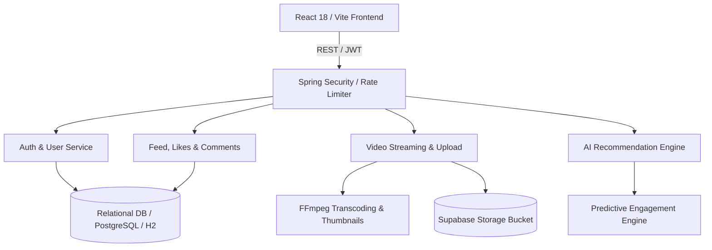

# Reelix - AI-Powered Short Video Content Sharing Platform

[](https://openjdk.org/projects/jdk/21/)
[](https://spring.io/projects/spring-boot)
[](https://react.dev/)
[](https://vitejs.dev/)
[](https://www.docker.com/)
[](https://render.com/)
[](https://vercel.com/)
[](https://opensource.org/licenses/MIT)

> **Capstone Project**  
> Developed by **Thiru** ([@csethirunavukkarasu-bit](https://github.com/csethirunavukkarasu-bit))  
> Repository: [capstone-project](https://github.com/csethirunavukkarasu-bit/capstone-project.git)

---

## 🌟 Executive Summary

**Reelix** is a high-performance, full-stack short video sharing platform engineered with **Java 21 (Spring Boot 3)**, **Supabase Cloud Storage**, **FFmpeg Media Pipeline**, and a responsive **React 18** client featuring modern glassmorphism aesthetics, in-browser video studio filters, real-time stories, and an AI recommendation engine.

---

## 🏗️ System Architecture



### Key Modules:
1. **Spring Boot 3 Backend (`backend/`)**:
   - **Authentication**: Stateless JWT token authentication with bcrypt password hashing and token-bucket rate limiting.
   - **Video Ingestion Pipeline**: Multipart file upload, automated FFmpeg resolution transcoding, aspect ratio detection, and thumbnail extraction.
   - **Distributed Cloud Storage**: Direct integration with Supabase Storage buckets for reliable media asset streaming.
   - **AI Recommendation Engine**: Hybrid algorithm combining user interaction vectors, tag affinity, and predictive engagement metrics.
   - **Social Graph & Feeds**: Chronological, trending, and personalized algorithmic feed generation with pagination.
   - **Production Readiness**: Actuator health telemetry, structured logging, and centralized global exception handling.

2. **Modern React Frontend (`frontend/`)**:
   - **3-Column Dashboard**: TikTok & Instagram Reels-inspired responsive layout with quick navigation, creator tools, and live widgets.
   - **Interactive Stories Carousel**: Real-time stories bar with full-screen auto-advancing story modal.
   - **Reelix Video Studio**: In-browser video trimmer, custom canvas filters, and thumbnail selector.
   - **Fluid Design System**: Curated HSL dark/light modes, glassmorphism panels, vibrant gradients, and WebAudio introductory chime.

3. **TypeScript Web Client (`backend/frontend/`)**:
   - Fully typed TypeScript client with strict compile-time safety and standalone modular components.

---

## 🚀 Getting Started Locally

### Prerequisites
- **Java Development Kit (JDK 21+)**
- **Maven 3.9+**
- **Node.js (v18+) & npm**
- **FFmpeg** (installed and added to system PATH)

### 1. Backend Setup (Spring Boot)

```bash
cd backend

# Configure environment variables (or copy example)
cp .env.example .env

# Build and run with Maven
mvn clean spring-boot:run
```
The backend API starts on `http://localhost:8080`.

### 2. Frontend Setup (React + Vite)

```bash
cd frontend

# Install dependencies
npm install

# Start Vite development server
npm run dev
```
The frontend UI starts on `http://localhost:5173`.

---

## 🐳 Docker & Container Orchestration

Run the entire full-stack application (PostgreSQL, Spring Boot with FFmpeg, and React Nginx) locally with a single command:

```bash
docker compose up --build
```

- **Frontend Application**: `http://localhost:80` (or `http://localhost:5173`)
- **Backend API**: `http://localhost:8080`
- **PostgreSQL Database**: `localhost:5432`

---

## ☁️ Cloud Deployment Guide

### A. Deploy Backend on Render (`https://render.com`)

1. **Create New Web Service**:
   - Link your GitHub repository: `csethirunavukkarasu-bit/capstone-project`
   - **Runtime**: `Docker`
   - **Root Directory**: `backend` (or leave root and select `./backend/Dockerfile`)
   - **Dockerfile Path**: `./backend/Dockerfile`
   - **Docker Context**: `./backend`
   - **Instance Type**: Free tier

2. **Configure Environment Variables in Render**:
   | Variable | Value | Description |
   | :--- | :--- | :--- |
   | `PORT` | `8080` | Port for Spring Boot container |
   | `SPRING_PROFILES_ACTIVE` | `prod` | Activates production profile |
   | `DATABASE_URL` | *Your PostgreSQL connection string* | Render / Supabase database URL |
   | `USE_IN_MEMORY_DB` | `false` *(or `true` for demo)* | Embedded H2 fallback if no external DB |
   | `SUPABASE_URL` | `https://your-project.supabase.co` | Supabase project URL |
   | `SUPABASE_KEY` | *Your Supabase service/anon key* | API key for storage bucket |
   | `SUPABASE_BUCKET` | `videos` | Storage bucket name |
   | `JWT_SECRET` | *Strong 32+ character random secret*| Secret key for signing tokens |

3. **Render Blueprint Alternative**:
   - The repository includes [`render.yaml`](file:///e:/capstone%20project/render.yaml) for 1-click Blueprints deployment including auto-provisioned PostgreSQL!

---

### B. Deploy Frontend on Vercel (`https://vercel.com`)

1. **Import Repository on Vercel**:
   - Connect GitHub account and select `capstone-project`.
   - **Framework Preset**: `Vite`
   - **Root Directory**: `frontend`
   - **Build Command**: `npm run build`
   - **Output Directory**: `dist`

2. **Configure Environment Variables in Vercel**:
   | Variable | Value | Description |
   | :--- | :--- | :--- |
   | `VITE_API_URL` | `https://reelix-backend.onrender.com` | Your deployed Render backend URL |

3. **SPA Routing**:
   - Both [`frontend/vercel.json`](file:///e:/capstone%20project/frontend/vercel.json) and [`vercel.json`](file:///e:/capstone%20project/vercel.json) are included to handle client-side routing rewrites seamlessly without 404 errors.

---

## 📡 Core API Endpoints

| Category | Method | Endpoint | Description |
| :--- | :--- | :--- | :--- |
| **Auth** | `POST` | `/api/auth/register` | Register new user account |
| **Auth** | `POST` | `/api/auth/login` | Authenticate user & return JWT |
| **Videos** | `POST` | `/api/videos/upload` | Upload video with metadata (multipart) |
| **Videos** | `GET` | `/api/videos/{id}` | Get video details & stream URL |
| **Feed** | `GET` | `/api/feed?page=0&size=10` | Get personalized/trending video feed |
| **Social** | `POST` | `/api/social/videos/{id}/like` | Like or unlike video |
| **Social** | `POST` | `/api/social/videos/{id}/comments`| Post comment on video |
| **AI** | `GET` | `/api/recommendations` | Get user interest-based recommendations |
| **System**| `GET` | `/api/health` | Service health and telemetry status |

---

## 🧪 Testing & Verification

- Backend unit & baseline test scripts:
  - `backend/run_java21_tests.bat`
  - `backend/test_java21.bat`
  - `backend/verify_cve_fix.bat`
- Frontend build validation:
  ```bash
  cd frontend
  npm run build
  ```

---

## 📄 License

This capstone project is released under the **MIT License**.
